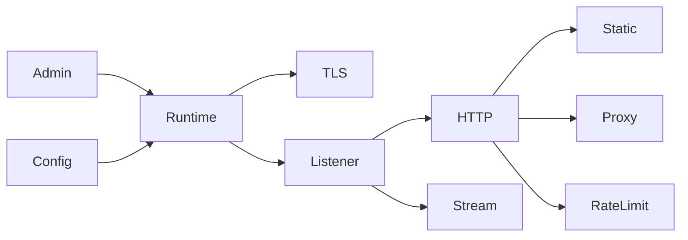

# Rocky architecture

Rocky runs as one Linux process with a Tokio runtime and one local administration socket. The first release serves HTTP/1.x over TCP, HTTP/2 over TLS, and HTTP/3 over QUIC. Its actions are static files, HTTP upstream pools, and dedicated TCP relays. Raw UDP relays and the shared HTTP cache belong to later milestones.

## Module interfaces

| Module | Interface and ownership |
| --- | --- |
| `config` | `Config::load` compiles versioned TOML, resolves paths from the configuration directory, and validates references and binds. It owns canonical host and path rules shared with request admission. |
| `runtime` | `Runtime` prepares and publishes a generation. It owns socket identities, the active binding table, resource reuse, admission counts, and retirement. |
| `listener` | TCP and QUIC adapters bind sockets, negotiate protocols, and translate requests, data frames, and trailers. The adapters signal protocol drain and bound its duration. |
| `http` | `Runtime::serve` admits a request using its connection metadata. It validates authority and targets, serves a local challenge or redirect, selects a route, and dispatches the admitted request. |
| `body` | One streaming `Body` carries data and trailers between adapters and actions. It enforces body limits and idle deadlines and carries permits through exchange completion. |
| `static_files` | `DocumentRoot` holds an open directory descriptor. It handles file selection, validators, ranges, and bounded streaming from the selected descriptor. |
| `proxy` | `ProxyPool` controls selection, DNS, health, reuse, forwarding fields, retry budget, and the upstream exchange deadline. |
| `rate_limit` | `RateLimiter` checks one client IP against a route's token bucket policy and owns all of that route's client state. |
| `tls` | `TlsManager` prepares listener configurations and manages active certificate identities and background jobs. `TlsGeneration` exposes ready certificates and challenge responses to the request path. |
| `stream` | A relay owns its admitted forwarding rule, connect and idle deadlines, half-closes, and byte counts. |
| `admin` | The Unix socket implements local reload and status. The CLI uses the same validation and preparation code as daemon startup. |

The Hyper and HTTP/3 adapters pass `http::Request<Body>` and connection metadata to the same request interface. `Body` is polled on demand. The peer address comes from the admitted transport and stays fixed for the connection. Configuration contains values and references by name. Preparation resolves them into handles before publication.

## Publication and lifetime

The writer compiles the TOML, opens roots, checks manual certificates and trust roots, and binds candidate sockets. The candidate owns its new resources until the writer publishes one `ArcSwap` snapshot. Each driver checks its identity against the snapshot before admitting work. Drivers are reused by socket address and transport, and listeners retain separate TCP and QUIC policies. The published policy controls where each accepted connection is dispatched.

Requests on compatible connections read the active snapshot once per admission. A request captures its route resources and generation number and releases the snapshot before streaming. Bindings and selected TLS sites carry compatibility identities across route-only edits. A removed binding or incompatible connection receives a drain notification and has a finite deadline. QUIC keeps the UDP socket alive while its admitted connections drain. Streams retain their selected forwarding rule until they finish or the retirement deadline expires.

The writer activates health and certificate jobs after publication and retires jobs for removed identities. Prepared resources have no network side effects beyond binding sockets. A failed preparation drops its candidate resources and leaves the active generation in service. The configured Unix socket and certificate state directory are process identities and require restart to change.

## Limits and local status

Each listener and the process bound accepted connections. Each HTTP transport bounds single-connection stream and header work, and a process-wide permit follows each admitted HTTP exchange through its body. File work, endpoint concurrency, upstream idle pools, ACME orders, and client token buckets have separate budgets. Body limits and timeouts apply during streaming, so a blocked exchange does not need an unbounded queue.

`rocky status` returns JSON over a private Unix socket with the generation, listener and certificate readiness, endpoint health, and aggregate counters and timings. Request logs use configured names for attribution and omit query strings, headers, and bodies.

## Implementation choices

- The TLS provider is Rustls with `ring`. Each transport has its own handshake configuration. HTTP/3 uses the TLS certificate slots shared with TCP and a Quinn endpoint per UDP bind. Connections use a full handshake without early data or session resumption.
- Static routes default to `index.html`. Set `index = ""` to disable directory indexes. Mount paths use normalized segment prefixes, and the file lookup receives only the suffix.
- Listener `default_site` applies to hostless HTTP/1.0 on plaintext and to SNI-less TLS. Site properties `public_https_port` and `public_quic_port` can override the ports inferred from its assigned listeners.
- An ACME site must have a plaintext HTTP/1.x listener for HTTP-01 and at least one TLS listener. The deployment maps public TCP port 80 to the challenge listener. Both ACME and upstream HTTPS can use configured PEM trust roots for private issuers.
- Reload compatibility is based on effective settings and prepared resource identities. Tests can exercise the same paths over loopback sockets, including successful publication and rejected candidates.
